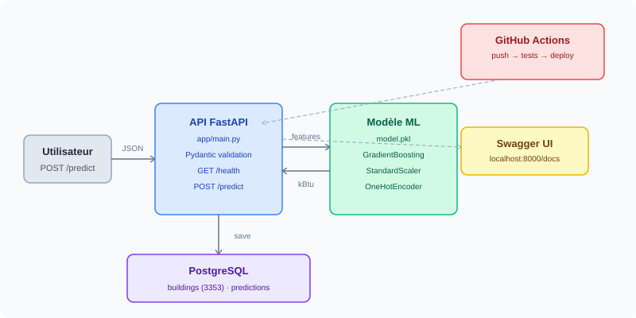

# Prédiction de la consommation énergétique des bâtiments de Seattle

Projet de machine learning visant à prédire la consommation énergétique (`SiteEnergyUse` en kBtu) de bâtiments commerciaux à Seattle, à partir du dataset public *2016 Building Energy Benchmarking*.

---

## Contexte

La ville de Seattle impose aux bâtiments de plus de 20 000 pieds carrés de déclarer annuellement leur consommation énergétique. Ce projet exploite ces données pour construire un modèle de régression permettant d'estimer la consommation à partir de caractéristiques structurelles du bâtiment, sans avoir besoin des relevés de compteurs.

---

## Architecture du projet



```
├── app/                  # API FastAPI
│   ├── main.py           # Endpoints de l'API
│   ├── schemas.py        # Modèles Pydantic (input/output)
│   ├── predict.py        # Chargement du modèle et inférence
│   └── database.py       # Connexion PostgreSQL
├── data/
│   ├── raw/              # Dataset brut (non versionné)
│   └── processed/        # Données nettoyées
├── models/               # Modèle entraîné (non versionné)
├── scripts/
│   ├── create_db.py      # Création de la base PostgreSQL
│   └── insert_data.py    # Insertion du dataset
├── tests/                # Tests unitaires et fonctionnels
│   ├── test_api.py
│   ├── test_model.py
│   └── test_db.py
├── docs/                 # Documentation technique
├── notebooks/            # Notebook d'exploration
├── .github/workflows/    # CI/CD GitHub Actions
├── Dockerfile
├── requirements.txt
└── README.md
```

---

## Modèle

- **Algorithme :** `GradientBoostingRegressor` (scikit-learn)
- **Pipeline :** StandardScaler (numériques) + OneHotEncoder (catégorielles) + GBR
- **Optimisation :** GridSearchCV (5-fold CV)
- **Meilleurs hyperparamètres :** `n_estimators=300`, `max_depth=3`, `learning_rate=0.05`, `min_samples_leaf=5`
- **Performances :** R² = 0.715 | MAE (log) = 0.48 sur le jeu de test

### Features d'entrée

| Feature | Type | Description |
|---|---|---|
| `log_surface_totale` | Numérique | Log de la surface totale (GFA) |
| `log_surface_batiment` | Numérique | Log de la surface construite |
| `ratio_surface` | Numérique | Ratio surface bâtiment / surface totale |
| `building_age` | Numérique | Âge du bâtiment (2016 - YearBuilt) |
| `NumberofFloors` | Numérique | Nombre d'étages |
| `NumberofBuildings` | Numérique | Nombre de bâtiments sur la parcelle |
| `has_electricity` | Binaire | Utilise l'électricité |
| `has_gas` | Binaire | Utilise le gaz naturel |
| `has_steam` | Binaire | Utilise la vapeur |
| `nb_sources_energie` | Numérique | Nombre de sources d'énergie |
| `PrimaryPropertyType` | Catégorielle | Type d'usage principal (OHE) |
| `tranche_age` | Catégorielle | Tranche d'âge du bâtiment (OHE) |
| `tranche_surface` | Catégorielle | Tranche de surface (OHE) |

### Cible

- `log_conso` : log1p de `SiteEnergyUse(kBtu)` — reconverti avec `np.expm1` dans la réponse API

---

## Installation

### Prérequis

- Python 3.11+
- PostgreSQL 17+
- Git

### Cloner le projet

```bash
git clone https://github.com/fatimaadda2878/seattle-energy-prediction.git
cd seattle-energy-prediction
```

### Créer l'environnement virtuel

```bash
python -m venv .venv
source .venv/bin/activate        # Linux / macOS
.venv\Scripts\activate           # Windows
```

### Installer les dépendances

```bash
pip install -r requirements.txt
```

### Configurer les variables d'environnement

```bash
cp .env.example .env
# Éditer .env avec tes identifiants PostgreSQL
```

---

## Lancer l'API

```bash
uvicorn app.main:app --reload
```

L'API est disponible sur `http://localhost:8000`.
La documentation Swagger est accessible sur `http://localhost:8000/docs`.

---

## Lancer les tests

```bash
pytest --cov=app tests/ -v
```

---

## CI/CD

Le pipeline GitHub Actions se déclenche automatiquement à chaque push :
1. Installation de Python 3.11 et des dépendances
2. Exécution des tests pytest avec rapport de couverture
3. Déploiement sur Hugging Face Spaces (branche main uniquement)

---

## Conventions de branches

| Branche | Usage |
|---|---|
| `main` | Code stable, déployé en production |
| `develop` | Intégration des features avant merge sur main |
| `feature/<nom>` | Développement d'une nouvelle fonctionnalité |
| `fix/<nom>` | Correction de bug |

---

## Auteur

Fatima Adda-Rezig
